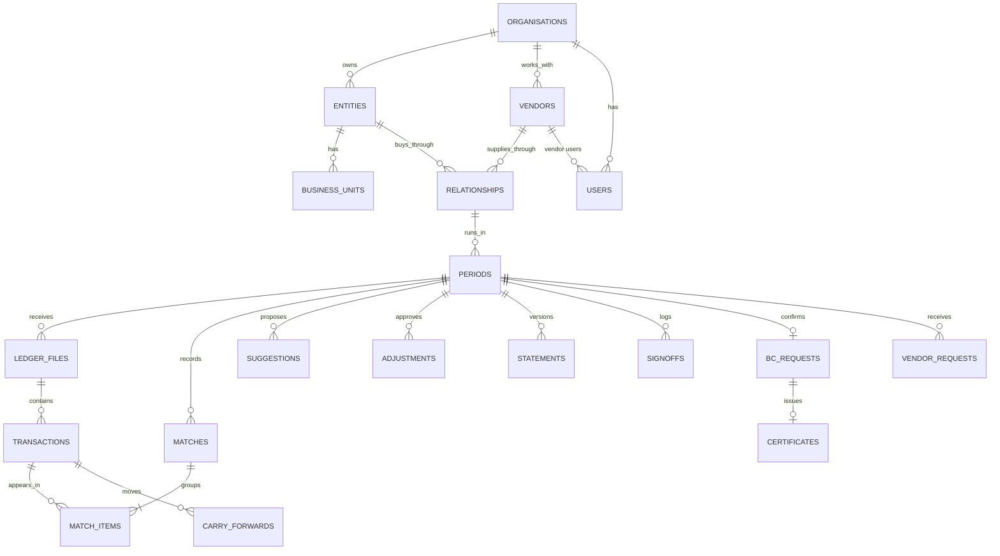
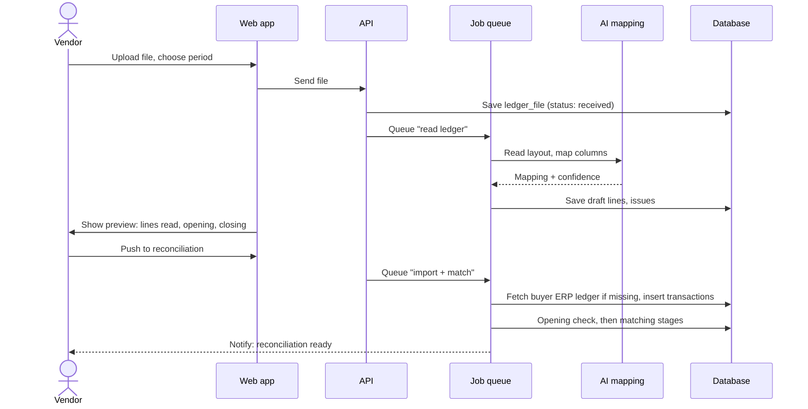
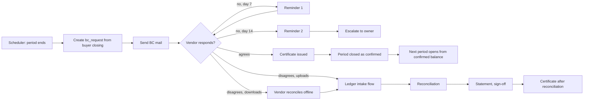

# Recon Platform Architecture

A simple architecture for the production Vendor Payable Reconciliation platform. The demo already proves the logic (opening checks, staged matching, annexures, statements, sign-off, balance confirmation and the vendor portal). This document shows what it takes to run that for real clients: the parts of the system, the tables behind it, how they connect, and the screens on top.

Published view with the same content: https://claude.ai/artifact/GMjA1zY79mvanfGuNMv1CS

**Shape:** modular monolith · TypeScript end to end · PostgreSQL · file storage + job queue · multi-tenant.

---

## 1. What the platform does, in order

Every table and screen below supports one of these steps, for one vendor relationship and one period at a time.

1. **Balance confirmation**: send our closing balance. Agreed: certificate, period closed, no reconciliation.
2. **Ledger intake**: buyer ledger from the ERP; vendor ledger uploaded in their format or ours, read by AI.
3. **Opening check**: each opening must equal that party's previous closing. Differences need approval.
4. **Matching**: contra, then invoices, credit notes, payments, TDS, payment + TDS, others. Suggestions wait for a person.
5. **Review**: confirm suggestions, match manually, force partial matches, track open items.
6. **Statement**: closing per buyer, annexures 1–9, closing per vendor. Annexures add up to the difference.
7. **Sign-off**: prepare, share, vendor accepts or disputes, approver signs. Changes reopen as a new version.
8. **Close and carry forward**: open items move to the next period, which opens from this closing.

## 2. System layers

Start as one backend application split into clear modules, not microservices. It is cheaper to run and change, and any module can be pulled out later if it needs to scale on its own.

| Layer | Parts |
|---|---|
| People | Buyer finance team (preparer, approver, admin) · Vendor users (own account only) · NXT operations (onboarding, support, job monitoring) |
| Web app | Buyer workspace (React + Vite, the current screens) · Vendor portal (same app, scoped by role and vendor) · Marketing site (separate, stays on Vercel) |
| API + modules | Auth & access · Master data · Ingestion (upload, AI layout mapping, validation, ERP pull) · Recon engine (today's `cycle.ts`, run on the server) · Workflow (reviews, vendor requests, approvals, sign-off) · Balance confirmation (requests, reminders, certificates) · Reports (Excel pack, PDF, certificates) · Notifications (email now, WhatsApp later) · Audit (append-only) |
| Data & background | PostgreSQL (row-level security per client) · S3-compatible file storage (ledgers, evidence, certificates) · Job queue + scheduler (imports, matching runs, reminders, ERP pulls) · AI service (layout reading and column mapping via an LLM API) |
| Outside systems | Client ERPs (Tally, SAP, Zoho Books and others, scheduled extracts) · Email provider · Single sign-on (optional, larger clients) |

> **Reuse what is built.** The demo engine is written as pure functions: state in, new state out, with no screen code inside. In production the same functions run in the API, reading from and writing to the tables below instead of browser memory.

## 3. Database tables

About 30 tables in eight groups. Every table carries `org_id` (the client) so one database can safely serve many clients. Amounts are `numeric(18,2)`, never floating point. Only the important columns are listed.

### 3.1 Clients and access
| Table | Key columns |
|---|---|
| `organisations` | id, name, plan, status, created_at (one per client) |
| `entities` | id, org_id, name, gstin, pan, base_currency |
| `business_units` | id, entity_id, name |
| `users` | id, org_id, name, email, kind (buyer \| vendor \| nxt), vendor_id?, status, last_login_at |
| `user_roles` | user_id, role (preparer \| approver \| admin \| vendor), scope_entity_id?, scope_bu_id? |

### 3.2 Master data
| Table | Key columns |
|---|---|
| `vendors` | id, org_id, code, legal_name, display_name, gstin, pan, category, status, contact_name, contact_email |
| `relationships` | id, entity_id, bu_id, vendor_id, vendor_code, currency, frequency, owner_user_id, status (the unit of reconciliation) |
| `periods` | id, relationship_id, tag, start_date, end_date, phase (working → prepared → shared → accepted/disputed → signed → closed), version, opening_b, opening_v, closing_b, closing_v, prev_closing_b, prev_closing_v, confirmed_cert_id? |
| `settings` | org_id, tolerance by currency, suggestion threshold, date window, timing days, stages on/off |

### 3.3 Ledger intake
| Table | Key columns |
|---|---|
| `ledger_files` | id, relationship_id, period_id, side (B \| V), kind (period \| backdated \| historical), source (upload \| erp \| onboarding), storage_key, file_name, opening, closing, status, uploaded_by, uploaded_at |
| `column_mappings` | id, vendor_id, layout_fingerprint, mapping (json: their column → our field, confidence), approved_by |
| `transactions` | id, relationship_id, file_id, side, type (INV, DN, CN, PAY, TDS and reversals), doc_no, doc_norm, doc_date, ref, ref_norm, against_doc, amount (signed), narration, origin_period_id, imported_period_id, line_no, row_hash, raw (json) |
| `import_issues` | file_id, line_no, kind (rejected \| duplicate \| warning), reason |

### 3.4 Matching
| Table | Key columns |
|---|---|
| `matches` | id, relationship_id, period_id, kind (match \| contra \| adjustment), stage, rule, confidence (exact \| rule-based \| probable \| manual), partial, difference, reversed, reversed_reason, created_by, created_at |
| `match_items` | match_id, transaction_id, side |
| `suggestions` | id, period_id, stage, kind, score, reasons (json), status (pending \| confirmed \| rejected \| superseded), decided_by, decided_at |
| `suggestion_items` | suggestion_id, transaction_id |
| `stage_runs` | period_id, stage, considered, matched, match_amount, suggestions, run_by, run_at, engine_version |
| `credit_maps` | note_txn_id, invoice_doc, method (reference \| suggested \| manual), by, at |

### 3.5 Open items and adjustments
| Table | Key columns |
|---|---|
| `open_item_status` | transaction_id, status, owner_user_id, priority, next_action, resolution_ref (only items someone has touched) |
| `item_notes` | transaction_id, period_id, text, by, at |
| `attachments` | id, linked_type, linked_id, storage_key, file_name, by, at |
| `adjustments` | id, period_id, kind (opening-continuity \| opening-position \| rounding \| accounting), side, amount, transaction_ids, reason, evidence, requested_by, approved_by, status |
| `carry_forwards` | transaction_id, from_period_id, to_period_id, at |

### 3.6 Statement and sign-off
| Table | Key columns |
|---|---|
| `statements` | id, period_id, version, buyer_closing, vendor_closing, difference, unexplained, snapshot (json: annexures and items, frozen), generated_at |
| `annexure_totals` | statement_id, annexure_no (1–9), section, item_count, effect (for dashboards) |
| `signoffs` | period_id, version, event (prepared \| shared \| accepted \| disputed \| signed \| reopened \| closed), by, vendor_rep, comments, at |

### 3.7 Vendor collaboration and balance confirmation
| Table | Key columns |
|---|---|
| `vendor_requests` | id, period_id, kind (match \| reverse \| confirm \| reject), payload (json), reason, status, requested_by, decided_by, decided_at |
| `credit_note_submissions` | id, relationship_id, period_id, cn_no, cn_date, cn_type (taxable \| non-taxable), taxable_value, cgst, sgst, igst, total, irn, attachment_id, via (form \| bulk), bulk_id?, status (submitted \| accepted \| rejected \| reopened), reason, submitted_by (vendor, L1), decided_by (buyer, L2), decided_at |
| `credit_note_allocations` | submission_id, buyer_txn_id, amount (how much of the credit note covers each buyer debit note; the "agreed, awaiting vendor ledger" record that reconciliation matches against once the CN number appears in the vendor ledger) |
| `credit_bulk_uploads` | id, relationship_id, file_name, storage_key, rows, uploaded_by, uploaded_at |
| `bc_requests` | id, relationship_id, period_id, balance, sent_at, due_at, status (not sent \| awaiting \| escalated \| confirmed \| disputed), route (upload \| download), remarks, responded_by, responded_at |
| `bc_reminders` | bc_request_id, step (R1 \| R2 \| escalation), sent_at, channel |
| `certificates` | id, cert_no, period_id, kind (confirmed \| reconciled), balance, issued_at, storage_key |

### 3.8 Platform
| Table | Key columns |
|---|---|
| `audit_log` | id, org_id, actor_user_id, action, object_type, object_id, period_id?, before (json), after (json), reason, ip, at (append-only) |
| `jobs` | id, type (import \| match \| reminder \| erp_pull \| report), payload, status, attempts, error, run_at |
| `notifications` | id, user_id, channel, template, payload, status, sent_at |
| `erp_connections` | entity_id, system, credentials_ref (secret store, never the secret), schedule, last_success_at |

## 4. How the core tables link

Everything hangs off a **relationship** (one entity, business unit, vendor and currency) and its **periods**. A transaction belongs to one ledger file; matches and suggestions point at transactions through their item tables, so one match can cover any number of entries on either side.

> **Nothing is stored twice.** Open items are not a table: an item is open when it has no active, non-partial match. Statements are the one exception: when a statement is prepared its annexures are frozen into a snapshot, so what the vendor signed can never change underneath them.

## 5. Key flows

Heavy work runs as background jobs, so a large ledger never blocks the screen. The screen shows progress and a notification arrives when it is done.

### Vendor uploads a ledger

### Balance confirmation cycle

### Close the month
Prepare (statement frozen as version *n*) → share with vendor → vendor accepts or disputes → approver signs off → close. Closing writes the carry-forward rows and creates the next period with `prev_closing` filled in. Any change after preparing reopens the period as version *n+1*; earlier versions stay readable.

## 6. Screens and what sits behind them

All screens exist in the demo except where marked. Vendor users see the same screens filtered to their own vendor; anything they change becomes a request for the buyer to approve.

| Screen | Used by | Main tables | Main actions |
|---|---|---|---|
| Sign-in *(new)* | Buyer, Vendor | users, user_roles | Email one-time code, or SSO |
| Dashboard | Buyer, Vendor | relationships, periods, annexure_totals, suggestions, vendor_requests | Status of every vendor, values by annexure, jump to next step |
| Vendor Ledger Upload | Buyer, Vendor | ledger_files, column_mappings, import_issues, periods | Upload (own or standard format), review AI reading, opening check, ledger history |
| Reconciled Transactions | Buyer, Vendor | matches, match_items, transactions | Filter by type, search, reverse a match (vendor: request) |
| Unreconciled Transactions | Buyer, Vendor | transactions, suggestions, matches (partial), open_item_status, item_notes, attachments, vendor_requests | Confirm/reject suggestions; manual, contra and force match; notes and evidence; approve vendor requests |
| Reconciliation Statement | Buyer, Vendor | statements, signoffs, adjustments | Bridge and annexures, prepare, share, accept or dispute, sign off, close, Excel pack |
| Balance Confirmation | Buyer, Vendor | bc_requests, bc_reminders, certificates | Tracker, send and remind; vendor agrees or disagrees; certificates for every period |
| Credit Mapping *(planned)* | Buyer | credit_maps, transactions | Tie credit and debit notes to invoices |
| Admin Settings | Admin | settings, users, user_roles, vendors, relationships, erp_connections | Tolerances and stages, users and vendor map, relationships, ERP schedule |
| Audit log | Buyer, Admin | audit_log | Read-only history, filter and export |
| NXT console *(new, internal)* | NXT ops | organisations, jobs, notifications | Onboard a client, watch failed jobs, resend mails |

## 7. API outline

Plain REST over HTTPS. Every route checks the user's client and role before touching data. Long work returns a job id instead of waiting.

| Area | Routes |
|---|---|
| Setup | `POST /auth/otp`, `POST /auth/verify`, `GET /entities`, `GET /vendors`, `GET/POST /relationships`, `GET /relationships/:id/periods` |
| Ledgers | `POST /periods/:id/ledgers` (upload → job), `GET /ledgers/:id/preview`, `POST /ledgers/:id/push`, `GET /periods/:id/opening-check` |
| Matching and review | `GET /periods/:id/matches`, `GET /periods/:id/open-items`, `GET /periods/:id/suggestions`, `POST /suggestions/:id/decide`, `POST /periods/:id/matches` (manual, contra, force), `POST /matches/:id/reverse`, `POST /vendor-requests/:id/decide` |
| Statement and confirmation | `GET /periods/:id/statement`, `POST /periods/:id/{prepare,share,respond,signoff,close,reopen}`, `GET /periods/:id/statement.xlsx`, `POST /bc-requests/:id/{send,remind,respond}`, `GET /certificates/:id/file` |

## 8. Rules the system must enforce

Enforce these in the API, never only on screen.

- **One sign convention**: invoices and debit notes add; credit notes, payments and TDS reduce. Stored signed, from the payable side.
- **Opening before matching**: no matching until both openings continue from the last close, or the difference is approved with a reason and evidence.
- **Nothing closed on a guess**: only exact and rule-based matches close by themselves. Suggestions always need a person.
- **Annexures equal the difference**: a statement can be prepared only when nothing is unexplained beyond the approved rounding tolerance.
- **Locked after preparing**: changes need a reopen by an approver; it becomes a new version and the old one is kept.
- **Vendors propose, buyers decide**: vendor matches, reversals and decisions are stored as requests until a buyer approves them.
- **Duplicates refused at the door**: a row hash per line stops the same entry being imported twice, even across files.
- **Every change is audited**: who, when, what before and after, and why. The audit table only ever gets new rows.

## 9. Security and access

- **Client isolation**: every row carries `org_id`; PostgreSQL row-level security makes one client's data invisible to another even if a query is wrong.
- **Roles**: preparer does the work, approver signs and approves differences, admin manages settings and users, vendor sees only their own vendor.
- **Sign-in**: email one-time codes to start; SSO for larger clients. Short sessions, sign-out everywhere.
- **Files**: private bucket, links that expire in minutes, virus scan on upload, size and type limits.
- **Secrets**: ERP credentials in a secret store, never in the database or code. Encryption at rest and in transit.
- **Data protection**: Indian region for Indian clients, a retention policy per client, and a data processing agreement, in line with India's DPDP Act.

## 10. Build order

Each phase is usable by real clients on its own. The demo screens carry over; the work is mostly the backend underneath them.

| Phase | Goal | Scope |
|---|---|---|
| 1 · Pilot-ready | One client, real ledgers | Sign-in, clients, roles · Master data and relationships · Upload in the standard format (CSV/Excel) · Engine on the server, matching as a job · Review screens, statement, Excel pack · Audit log |
| 2 · Vendor-facing | Vendors do their part | Vendor portal sign-in · AI reading of vendor layouts · Balance confirmation with email reminders · Vendor requests and approvals · Certificates and PDF |
| 3 · Scale | Less manual work | ERP connectors on a schedule · Credit mapping screen · Learned matching patterns per vendor · NXT console, usage and billing · SSO and data residency options |

**Suggested stack**, all TypeScript so the engine is shared: React web app (as now), a Node.js API (Fastify or NestJS), PostgreSQL with an ORM such as Drizzle or Prisma, an S3-compatible bucket, and a job queue (BullMQ on Redis, or pg-boss on PostgreSQL to keep fewer moving parts). Managed hosting for the database and API keeps operations light while the team is small.

---

*Prepared from the Vendor Payable Reconciliation demo. Table and column names are a starting design to refine with the first pilot client.*
